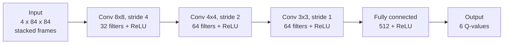
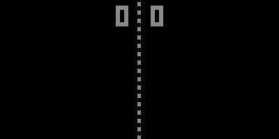

# Deep Q-Learning: Atari Pong

A Deep Q-Network written from scratch with PyTorch and Gymnasium that learns Atari Pong from screen pixels. After 800,000 training steps it wins every game against the computer, most of them 21-0.

## Project

Group members: Shima Serein and Gaddiel Irakoze. The [task allocation sheet](Task%20allocation%20sheet.pdf) lists who did what.

The environment is `ALE/Pong-v5`. Our agent controls the right paddle and gets +1 for each point it wins and -1 for each point it loses, so a game scores between -21 and +21.

## DQN architecture



The agent chooses actions epsilon-greedily and stores every step in a replay buffer of 50,000 steps. It learns from random batches of those steps, using the Bellman target `r + gamma * max Q_target(s', a')` and a Huber loss, and copies its weights into the target network every 1,000 steps. [docs/architecture.md](docs/architecture.md) explains each part and has a diagram of the training loop.

## Results

| | |
|---|---|
| Best configuration | learning rate 0.0001, gamma 0.99, batch 32, epsilon 1.0 to 0.02 over 100,000 steps |
| Final training | 800,000 steps, average reward +19.9 over the last 10 games |
| Evaluation (`play.py`) | won all 10 games, average +20.7 (7 games 21-0, 3 games 21-1) |

The training plot and what it shows are in [docs/results.md](docs/results.md), which also explains [why we kept this configuration](docs/results.md#why-the-baseline-and-not-gaddiels-combination) although Gaddiel's combination scored higher at 200,000 steps. Each member's hyperparameter experiments have their own file ([Shima](results/Shima_Serein_Hyperparameter_experiment_results.md), [Gaddiel](results/Gaddiel_Irakoze_Hyperparameter_experiment_results.md)), with an overview in [docs/experiments.md](docs/experiments.md).

## Gameplay demonstration



`play.py` draws the game in black and white with [`tools/retro_view.py`](tools/retro_view.py), while the agent still sees the original Atari frames. Full games: [game 1](videos/pong-dqn-episode-0.mp4), [game 2](videos/pong-dqn-episode-1.mp4), [game 3](videos/pong-dqn-episode-2.mp4).

## Quick start

```bash
uv sync                                                   # install
uv run play.py                                            # watch the trained agent play
uv run train.py --help                                    # train one configuration
uv run tools/experiments.py --member shima --parallel 2   # run a member's 10 experiments
```

We trained on a free Colab T4 GPU; [docs/colab.md](docs/colab.md) has the steps.

## Repository layout

```
train.py            DQN training: network, replay buffer, target network, training loop
play.py             loads dqn_model.pth and plays in real time
dqn_model.pth       final trained agent
results/            each member's experiment table and observations
models/<member>/    every experiment's model, log, plot and config
tools/              experiments.py (each member's 10 configurations), retro_view.py (game display)
docs/               architecture, experiments, results, Colab training
notebooks/          Colab training notebook
videos/             gameplay recordings
```
