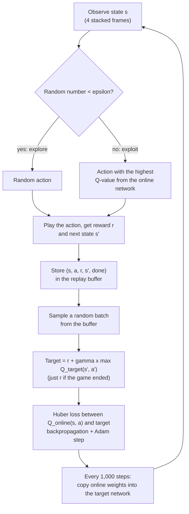

# DQN architecture

Everything here is implemented from scratch in [`train.py`](../train.py) with PyTorch. No RL library is used.

## Input preprocessing

`make_env()` builds `ALE/Pong-v5` with the standard DQN preprocessing:

- Each action is repeated for 4 frames, so the agent decides 15 times a second.
- Each 210x160 colour frame becomes an 84x84 grayscale image.
- The last 4 processed frames are stacked into one observation, so the network can see the ball's direction and speed.
- Sticky actions are off and each game starts with up to 30 random no-ops, as in the original DQN paper.

## Q-network

`QNetwork` is the network from DeepMind's DQN Nature paper (2015), trained from random weights.

| Layer | Settings | Output shape |
|---|---|---|
| Input | 4 stacked frames, pixels divided by 255 | 4 x 84 x 84 |
| Conv 1 | 32 filters, 8x8, stride 4, ReLU | 32 x 20 x 20 |
| Conv 2 | 64 filters, 4x4, stride 2, ReLU | 64 x 9 x 9 |
| Conv 3 | 64 filters, 3x3, stride 1, ReLU | 64 x 7 x 7 |
| Fully connected | 3136 to 512, ReLU | 512 |
| Output | one Q-value per action | 6 |

The convolutional layers find the paddles and the ball, and the fully connected layers turn that into a value for each action. There are two copies: the online network, which is trained, and the target network, a frozen copy that computes the training targets.

## Training process

1. Epsilon-greedy exploration (`select_action`, `epsilon_at`). Epsilon starts high, so most moves are random, and decays linearly to a small value, so the agent mostly plays the best move it knows.
2. Experience replay (`ReplayBuffer`). Every step goes into a buffer of the last 50,000 transitions. Training on random batches breaks the correlation between consecutive frames and reuses each experience many times.
3. Bellman target (`learn`). The value of an action is the reward now plus the discounted best value of the next state: `r + gamma * max_a' Q_target(s', a')`. When the game ends there is no future value.
4. Loss and update (`learn`). The Huber loss measures the gap between the online network's `Q(s, a)` and the target. Backpropagation and Adam update the online network.
5. Target network (`train`). The targets come from a copy of the network that is refreshed every 1,000 steps, so they stay fixed between refreshes instead of shifting with every update.

## Fixed settings

The same for every experiment:

| Setting | Value |
|---|---|
| Replay buffer | 50,000 transitions |
| Random steps before learning | 10,000 |
| Gradient steps | one per environment step |
| Target network update | every 1,000 steps |
| Optimizer | Adam |
| Reward clipping | -1, 0 or +1 |
| Gradient clipping | norm 10 |
| Seed | 42 |

"Done" in the buffer is only `terminated` (a real game end), not `truncated` (a time limit), so the next state's value still counts after a time-limit cut.
