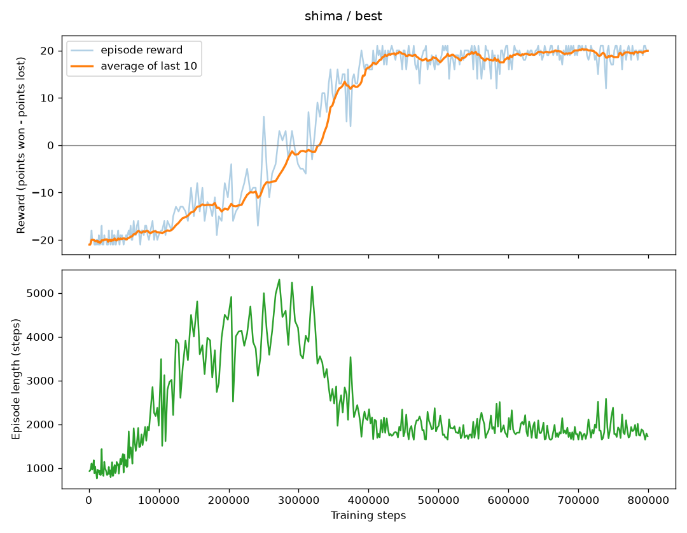

# Final agent

The best experiment was the baseline (learning rate 0.0001, gamma 0.99, batch size 32, epsilon 1.0 to 0.02 over 100,000 steps). It was trained again for 800,000 steps (382 games, about 90 minutes on a Colab T4) and saved as [`dqn_model.pth`](../dqn_model.pth).



| Training steps | Average reward (last 10 games) |
|---|---|
| 100,000 | -18.4 |
| 200,000 | -13.6 |
| 300,000 | -1.9 |
| 400,000 | +16.3 |
| 600,000 | +18.5 |
| 800,000 | +19.9 |

## What the episode length shows

1. For the first 50,000 steps or so, games last about 900 steps. The agent misses almost every ball and loses every point.
2. Between 50,000 and 300,000 steps, games get much longer and peak above 5,000 steps. The agent has learned to return the ball, so rallies last, but it rarely scores.
3. After 300,000 steps, games shorten to about 1,800 steps while the reward climbs to +20, because the agent now wins its points quickly. It won 41 of its training games 21-0.

[`models/shima/best/training_log.csv`](../models/shima/best/training_log.csv) has the episode length, total steps and reward of every game.

## Evaluation

`play.py` always picks the action with the highest Q-value and makes no random moves. It won all 3 recorded games 21-0: [game 1](../videos/pong-dqn-episode-0.mp4), [game 2](../videos/pong-dqn-episode-1.mp4), [game 3](../videos/pong-dqn-episode-2.mp4).

## Why the baseline and not Gaddiel's combination

At 200,000 steps Gaddiel's Experiment 1 (learning rate 0.0001, gamma 0.99, batch 64, epsilon 1.0 to 0.01 over 150,000 steps) averaged +12.0, far ahead of the baseline's -8.0. Both configurations were then trained for 800,000 steps with the same seed, and those longer runs decided the final agent.

| | Baseline (Shima) | Combination (Gaddiel) |
|---|---|---|
| Last 10 games at 200,000 steps, first run (`exp01`) | -8.0 | +12.0 |
| Last 10 games at 200,000 steps, 800,000-step run (`best`) | -13.6 | -6.6 |
| Last 10 games at 800,000 steps | +19.9 | +18.0 |
| 10 greedy games with `play.py` | +20.7 (won 7 games 21-0 and 3 games 21-1) | +12.4 (won all 10, by 11 to 15 points) |

1. One run per configuration is not enough to rank them. Each 800,000-step run repeated an `exp01` configuration with the same seed, and the two runs matched game for game until learning started at 10,000 steps. After that they drifted apart, because training on a GPU is not exactly repeatable. By 200,000 steps the baseline's two runs were 5.6 points apart and Gaddiel's 18.6 points apart. His combination was ahead at 200,000 steps both times, so it does seem to learn faster early on, but part of the 20-point gap was luck.
2. Learning faster early did not give the better final agent. At 800,000 steps the baseline was slightly ahead in training and clearly ahead in greedy play. With sticky actions off, the only randomness in a greedy game is the 0 to 30 no-ops at the start, so each agent plays almost the same game every time: the baseline's game wins 21-0 or 21-1, while Gaddiel's agent repeats a pattern that loses points. During training 1% of its moves were random, which probably broke that pattern, so its training average (+18.0) is higher than its greedy score.

To repeat the evaluation:

```bash
uv run play.py --episodes 10
uv run play.py --model models/gaddiel/best/dqn_model.pth --episodes 10
```
